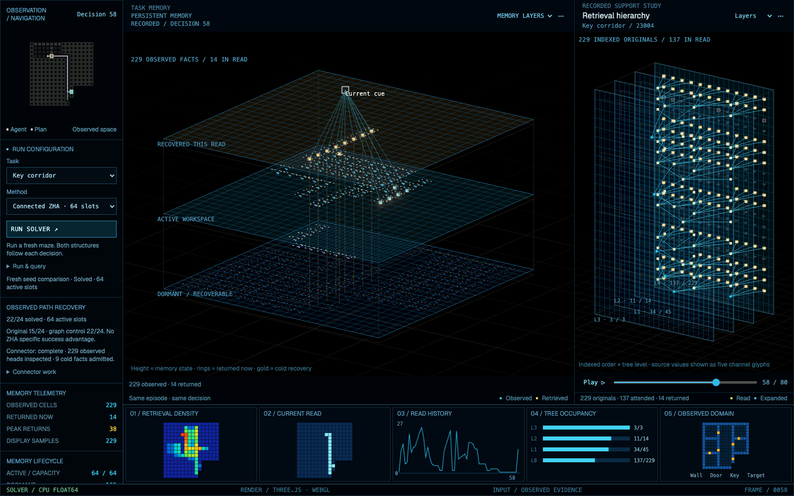

# Open Hierarchical Memory

Inspectable experiments in hierarchical retrieval, bounded working memory, reversible forgetting and replay.

A maze-solving agent can retain a landmark and still lose the observed path needed to use it. This project makes that failure visible, connects retrieved evidence to planning, and compares repairs against exact search and ordinary graph recovery.



**Development research reference.** The installed attention library supports CPU float 64 and the no-positional-encoding ZHA construction. The task demos use a shared symbolic planner. This is not a converted language model or a production agent-memory service.

## Try the dashboard

Python 3.12 or 3.13, uv, and a modern browser are required. Node.js is used for renderer tests and rebuilds.

```sh
git clone https://github.com/Prigoistic/open-hierarchical-memory.git
cd open-hierarchical-memory
make setup
make dashboard
```

Open [localhost:8792](http://127.0.0.1:8792/). Run & query → Saved study → **Path recovery · fresh seed study** opens the latest comparison. Choose a task/method and press **Run solver** for a fresh episode. The maze, memory layers and retrieval hierarchy share one timeline.

Originals, active memory, recovered sources, paths, checkpoints and work counters remain inspectable. Recordings and fresh execution have distinct labels. The separate continuous-world dynamics learner is available through advanced tools; a maze run does not train those separate neural networks.

## Latest measured result

Four official MiniGrid task families, six new seeds and five conditions: **120 runs over 24 initial worlds**.

| Reader | Solved | Active capacity |
| --- | --- | --- |
| Original fitted ZHA reader | 15/24 | 64 facts |
| Compact path packing | 16/24 | 64 facts |
| Connected ZHA recovery | 22/24 | 64 facts |
| Connected exact recovery | 22/24 | 64 facts |
| Connected graph recovery | 22/24 | 64 facts |

The improvement is available path support. Exact and graph controls match ZHA. Connector scans, graph search, archive/index storage and cached heads are additional costs; equal active capacity does not mean equal total memory or compute. Two Key Corridor failures remain. [Full results, costs and limitations](experiments/task-support-v1/SUMMARY.md).

## What is implemented

- **Hierarchical attention:** numerical summaries, top-p traversal, attention over selected original KV, dense controls, causal prefixes, budgets and source traces.
- **Persistent task memory:** immutable observations, correction versions, bounded active membership, reversible retirement and explicit cold recovery.
- **Task-useful support:** compact observed paths and prerequisites, with disclosed graph-based connector recovery.
- **Offline routing replay:** actual reference-parameter updates, uniform/priority/recent schedules, separate training/validation/evaluation and per-update source/work records.
- **Continuous-world rehearsal:** a separate small learned-dynamics prototype with predicted trajectories clearly separated from observed facts.
- **Official maze/puzzle experiments:** MiniGrid and Boxoban, preserved controls and failed outcomes.
- **One visual debugger:** fresh solves, recorded studies, source inspection and shared memory/retrieval playback.

Replay reduced fresh-prefix routing KL by 14.9% in its own study but did not improve task success; random references were a stronger KL control. The new path-support study makes no learning or biological-dreaming claim. [Replay evidence](experiments/task-replay-v1/SUMMARY.md).

## Numerical library

```sh
uv sync --locked
uv run --locked python examples/synthetic.py
```

The package API is `open_hierarchical_memory`: `HierarchicalIndex`, `TreeConfig`, explicit `ExecutionMode`, validated budgets and typed result/failure states. [API and method map](docs/METHOD.md).

The wheel and core source distribution exclude datasets, browser bundles and experiment archives. Use the Git checkout plus research/benchmark extras for the dashboard and studies. Original KV remains stored. Approximate routing has no per-query correctness guarantee; no whole-model or SDPA speed advantage is demonstrated.

## Verify and reproduce

```sh
make setup
make test
make verify
make support-study OUTPUT=experiments/my-new-support-run
```

`make verify` runs tests, lint/format, strict typing, semantic mutation checks, independent historical/current audits and two clean installed-artifact checks. `make test` also runs renderer behavior tests. New output directories are mandatory; experiments are never overwritten. Local verification is separate from hosted-CI startup or success.

## Navigate the project

- [Repository map](docs/REPOSITORY_MAP.md): numerical core, research, dashboard, tests and frozen evidence.
- [Current roadmap](docs/ROADMAP.md): remaining failures and research gates.
- [Implementation overview](docs/PROJECT_OVERVIEW.md): component boundaries and earlier results.
- [Dashboard guide](docs/UNIFIED_DASHBOARD.md): controls, provenance and local archives.
- [Support protocol](docs/TASK_SUPPORT.md), [replay protocol](docs/TASK_REPLAY.md), [progress record](PROGRESS.md).
- [Contributing](CONTRIBUTING.md), [security scope](SECURITY.md), [third-party notices](THIRD_PARTY_NOTICES.md).

This is an independent implementation of [Zyphra Hierarchical Attention](https://arxiv.org/abs/2610.42112), with credit to its authors and no affiliation with Zyphra. Our code is [Apache 2.0](LICENSE); third-party assets retain their own licenses.
