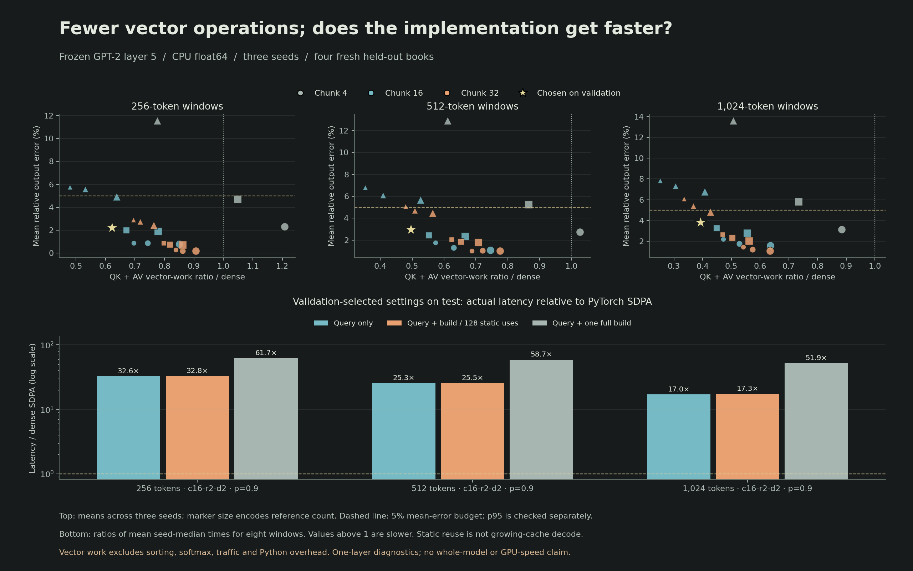

# Geometry and context cost-quality results

Completed 4 November 2026. This is the prespecified extension of the original GPT-2 layer pilot. It separates vector-work reduction, approximation error and actual execution time against dense PyTorch SDPA. No whole-model or optimized-GPU result is implied.

## Protocol and chronology

Seven geometries, three contexts (256/512/1024), three seeds, three routing thresholds, and three reference variants. The model remains frozen at layer 5. References receive 100 Adam steps per fit; the initial checkpoint remains eligible. There are 63 fits, 567 test configuration rows, and 189 timed fitted-reference settings. The [protocol and definitions](../../docs/COST_QUALITY.md) describe the error budget, work proxy, native prefix masking and timing scope.

The [original protocol commit](https://github.com/Prigoistic/open-hierarchical-memory/commit/bb44d48) predates fitting. A first-capture serialization failure was retained under [the failed preflight](../gpt2-cost-quality-v1-preflight-failed/run.log). It occurred before fitting or test capture. Only trace packing was fixed and regression-tested; the [successful run's source commit](https://github.com/Prigoistic/open-hierarchical-memory/commit/dc8b5c75f7b8bfe3fba8d03c94bb4df0ed2b91c0) retains the same numerical protocol. No failed attempt was replaced.

All 63 fits and validation choices finish before the new test split is captured. The [frozen selection record](selection-before-test.json) is hash-bound into the final report. Four new books (Gutenberg 345/1260/174/768), two windows each, yield 384 query/head cases per seed and setting. These books were not in the original pilot; they may still have appeared in GPT-2 pretraining. Nested contexts, neighboring queries, heads and seeds are dependent, not independent documents.

## Validation-selected configurations on fresh test data

Selection requires validation mean relative output error <=5% and p95 <=20%, then minimizes the declared QK+AV vector-work proxy. A test failure does not trigger retuning or replacement. Relative error divides output L2 error by the dense output norm, floored at 1e-12. These budgets describe this layer, not language-model quality.

| Context | Frozen geometry / p | Validation mean error | Test mean error | Test p95 error | Test budget | Vector work / dense | Selected keys |
| --- | --- | ---: | ---: | ---: | --- | ---: | ---: |
| 256 | c16-r2-d2 / 0.9 | 2.81% | 2.23% | 7.94% | Pass | 0.622 | 56.77% |
| 512 | c16-r2-d2 / 0.9 | 3.70% | 2.99% | 8.76% | Pass | 0.496 | 43.61% |
| 1024 | c16-r2-d2 / 0.9 | 4.13% | 3.84% | 8.70% | Pass | 0.393 | 33.83% |

The vector proxy counts reference scores, selected-key scores and value-vector accumulation. It excludes sorting, softmax, byte traffic and framework overhead. A ratio below one means fewer counted vector operations, not a measured speedup. Some nominal depth-2 geometries have only one completed summary level within these contexts; active levels are included in the report.

## Actual CPU timings and index costs

Times below cover a batch of eight windows with four query positions each. They are arithmetic means of three seed-level medians, not per-token decode latencies. Query-only timing excludes construction but includes the public hierarchical API's validation, copying, routing, gathering and result metadata. SDPA is checked against manual dense attention using explicit prefix masks, CPU float64 and zero dropout. No quality oracle or detailed route trace runs inside the timed paths.

| Context | Dense SDPA ms | Hierarchical query ms | Full batch build ms | Query speed ratio | One-use speed ratio | 128-use scenario | Owned index / raw KV tensors |
| --- | ---: | ---: | ---: | ---: | ---: | ---: | ---: |
| 256 | 0.679 | 22.104 | 19.779 | 0.0307× | 0.0162× | 0.0305× | 1.063× |
| 512 | 1.226 | 30.982 | 41.001 | 0.0396× | 0.0170× | 0.0392× | 1.065× |
| 1024 | 2.439 | 41.470 | 85.095 | 0.0588× | 0.0193× | 0.0579× | 1.066× |

Speed ratio is dense time divided by hierarchical time; below 1 is slower. The one-use figure adds a full tree build. The 128-use figure amortizes that build over repeated calls to the same static snapshot; it is not actual growing-cache decoding. The index retains original KV and adds summaries/references. Owned tensor bytes exclude caller storage, Python objects and scratch allocations; whole-process peak RSS in the report includes capture/training and is a different measurement.

## Fitting versus untrained references

At the validation-selected geometry and threshold, these are fresh-test mean relative errors pooled across seeds. They isolate the reference variants at the same geometry/threshold, which need not select identical numbers of keys.

| Context | Sampled-query initialization | Random references | Fitted references |
| --- | ---: | ---: | ---: |
| 256 | 2.59% | 1.96% | 2.23% |
| 512 | 3.12% | 2.89% | 2.99% |
| 1024 | 4.12% | 3.53% | 3.84% |

Do not infer that fitting always improves routing or that one small fixed training budget reaches convergence. The complete grid preserves all seeds, variants and thresholds, including unfavorable settings.

## Evidence and artifacts

- All 60 native capture checks pass. Maximum absolute reconstruction differences: weights 2.153e-06, preprojection outputs 1.560e-05. Loading reports no missing/unexpected/mismatched model keys or errors. Backbone parameter hashes stay identical.
- All 63 checkpoints round-trip before evaluation. At p=1, all eligible keys are selected across 21 geometry/context checks (8,064 query/head cases); maximum output L2 difference 9.640e-15.
- The [post-run audit](audit.json) independently recomputes 567 test and 63 validation aggregates from 254,016 raw records, checks frozen selection and source/checkpoint/trace hashes, verifies timing arithmetic and compares 24 real queries against the independent scalar oracle.
- Local verification: 78 tests, Ruff, formatting, strict package mypy, ten detected semantic mutations. Hosted CI remains blocked by the previously confirmed billing restriction; local evidence is not a hosted pass.
- [Full report](report.json), [selected summary](selected-summary.json), [complete grid CSV](grid.csv), [validation raw measurements](validation-queries.jsonl.gz), [test raw measurements](test-queries.jsonl.gz), [reference checkpoints](references/), [protocol snapshot](protocol.json), [run log](run.log), [SVG figure](cost-quality.svg), [plot provenance](plot-metadata.json).

Report SHA256: `1a81c83cf1d2f2e46b9ab2ab11e1d673183fec63e1cddbd79ffdf5043eb7b185`.

## Interpretation and remaining gates

The validation-selected settings pass the fixed test layer budget at 3/3 contexts. Their counted vector work spans 0.393–0.622 of dense work. The largest query-only speed ratio among these frozen choices is 0.0588× against SDPA. The current Python reference has not demonstrated a speed benefit. Reduced vector work is an algorithmic opportunity; a faster backend and larger supported contexts need their own measurements.

This study stays within GPT-2's 1,024 positions and cannot establish long-context scaling. RoPE adapters, broader domains/layers, end-to-end perplexity/generation, incremental tree maintenance and GPU kernels are open gates. Preserve the CPU float64 reference as the oracle for any faster backend. Do not infer model correctness from retained attention mass or a local output-error budget.
