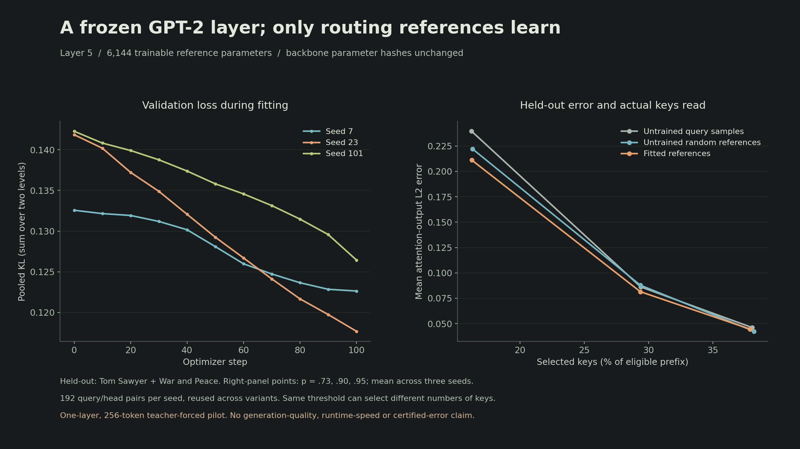

# Frozen GPT-2 layer pilot: measured results

Completed 4 November 2026. Reference-query fitting lowered held-out pooled KL in all three prespecified seeds. At routing threshold 0.73, mean attention-output L2 error fell 11.9% against the sampled-query initialization, while selected-key fractions were nearly equal. This is a small successful layer experiment, not evidence of whole-model quality or speed.

## Fixed setup

The [source and protocol were committed before fitting](https://github.com/Prigoistic/open-hierarchical-memory/commit/421e2bce01e6c6b515fa5017ec90c2314f39bf6e). Model: pretrained `openai-community/gpt2`, revision `607a30d783dfa663caf39e06633721c8d4cfcd7e`. Layer 5 (zero-based), 256-token contexts, chunk size 4, tree depth 2, eight references per head. Each seed fits 6,144 reference parameters; all 124,439,808 backbone parameters remain frozen.

Training uses 2,048 unique tokens across four books; validation uses two different books. Test uses two nonoverlapping windows each from *Tom Sawyer* and *War and Peace*, at four query positions and 12 heads: 192 query/head observations per seed, reused across variants and thresholds. These observations are dependent, not 576 independent documents. Held-out means excluded from reference fitting, not necessarily from GPT-2 pretraining. See the [full protocol](../../docs/GPT2_PILOT.md) and [data identities](../../research/gpt2_data_manifest.json).

Each seed runs 100 Adam steps; selection uses validation KL, including the initial checkpoint as a candidate. All three select step 100. The runner evaluates test only after all checkpoint selections. No settings were changed in response to the test results.

## All prespecified settings

Each cell below is the arithmetic mean of the three seed-level means. The report also includes per-seed and per-book means, medians and p95 values. KL sums over the two tree levels and is independent of the routing threshold.

| Threshold | References | Test pooled KL | Retained mass | Non-sink mass | Keys selected | Summary nodes scored | Output L2 error |
| --- | --- | ---: | ---: | ---: | ---: | ---: | ---: |
| 0.73 | Untrained query samples | 0.095473 | 91.47% | 80.50% | 16.23% | 22.65 | 0.239529 |
| 0.73 | Untrained random references | 0.099844 | 91.86% | 80.87% | 16.29% | 22.65 | 0.222224 |
| 0.73 | Fitted references | 0.083199 | 92.06% | 81.22% | 16.24% | 22.64 | 0.211129 |
| 0.90 | Untrained query samples | 0.095473 | 96.92% | 92.36% | 29.39% | 28.43 | 0.086220 |
| 0.90 | Untrained random references | 0.099844 | 96.87% | 92.49% | 29.36% | 28.44 | 0.087907 |
| 0.90 | Fitted references | 0.083199 | 97.01% | 92.71% | 29.36% | 28.40 | 0.081478 |
| 0.95 | Untrained query samples | 0.095473 | 98.44% | 95.97% | 38.05% | 31.44 | 0.046173 |
| 0.95 | Untrained random references | 0.099844 | 98.53% | 96.35% | 38.20% | 31.51 | 0.042503 |
| 0.95 | Fitted references | 0.083199 | 98.48% | 96.03% | 37.91% | 31.35 | 0.044580 |

At threshold 0.73, pooled KL changes from 0.095473 to 0.083199 (12.9% lower). Output error changes from 0.239529 to 0.211129, with keys selected changing from 16.23% to 16.24%. The random-reference baseline is close: fitted output error is 5.0% lower than random at this setting. At higher thresholds the differences are smaller and mixed. This does not establish universal dominance or statistical significance.

Selected-key percentage omits summary construction, summary scoring, storage and framework overhead. Same threshold does not guarantee matched cost. High total retained mass can also conceal weak non-sink retrieval, which is reported separately. Neither the routing threshold nor these offline mass measurements constitutes a runtime error certificate.

| Seed | Initial test KL | Fitted test KL | Selected step |
| --- | ---: | ---: | ---: |
| 7 | 0.111079 | 0.093893 | 100 |
| 23 | 0.078999 | 0.071851 | 100 |
| 101 | 0.096340 | 0.083854 | 100 |

## Integrity and independent checks

- Pretrained loading reports no missing, unexpected or mismatched keys or loader errors. Native float32 attention is reconstructed from explicitly converted float64 Q/K/V across 16 windows. Maximum absolute differences: weights 1.110e-06; preprojection outputs 4.330e-06.
- Backbone parameter hashes match before and after fitting/evaluation; no backbone gradients occur. Saved reference checkpoints reload exactly before test evaluation.
- At threshold 1, selected IDs cover every eligible key. Maximum output L2 difference from dense attention is 3.573e-15 across 192 observations per seed.
- The [post-run audit](audit.json) binds source/config/data identities to the preregistration commit, checks checkpoint and measurement hashes, recomputes all 27 configuration aggregates from 5,184 raw records, and compares eight real queries against the independent scalar oracle. These eight cases span both test books, heads 0/11 and thresholds 0.73/0.95; they are a scoped check, not exhaustive proof.
- The local research-enabled suite passes 70 tests, Ruff, formatting, strict package typing and all 10 semantic mutation checks. Wheel and source distributions were installed and exercised in fresh offline environments. [Local evidence](../../docs/evidence/local-verification.json) is separate from hosted CI, which remains blocked by the account's billing restriction.

## Artifacts and reproduction

- [Protocol snapshot](protocol.json), [complete report](report.json), [raw query metrics](query-metrics.jsonl), [audit](audit.json).
- Reference checkpoints: [seed 7](references-seed-7.safetensors), [seed 23](references-seed-23.safetensors), [seed 101](references-seed-101.safetensors). These are routing references only, not GPT-2 model weights.
- Figure: [PNG](pilot-summary.png), [SVG](pilot-summary.svg), [plot provenance](plot-metadata.json).
- [Reproduction and audit commands](../../docs/GPT2_PILOT.md#reproduction). Model weights, raw texts and full activation caches stay outside Git in ignored local storage.

Report SHA256: `7449d597dafd280410f0ac4df0ffb73cda647877726c3f8003cf9a1a228164ea`.

The next useful evidence is a predeclared extension across more contexts/layers and an inspector that exposes individual routing failures. This pilot does not evaluate RoPE, long-context scaling, closed-loop sparse generation, perplexity, GPU kernels, runtime speed, conservative bounds or a production memory system. Do not present it as reproducing the paper's benchmark results.
